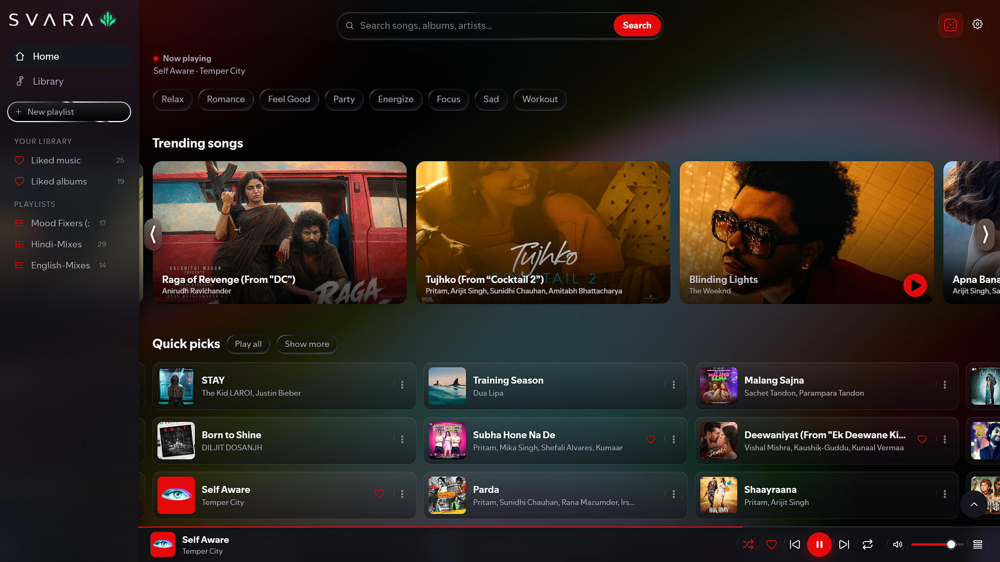
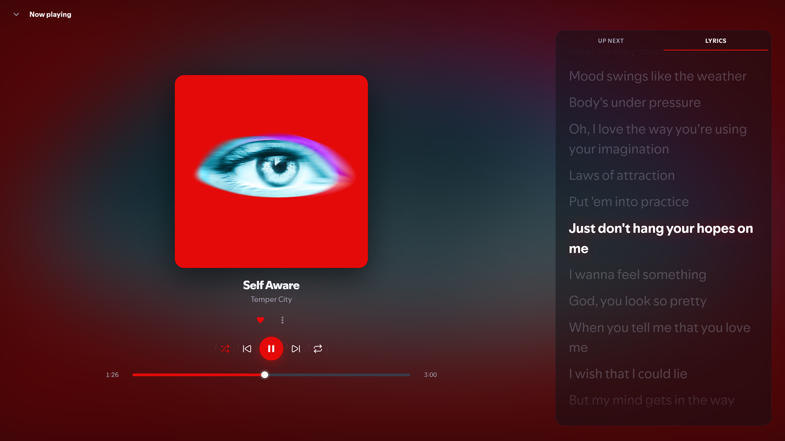
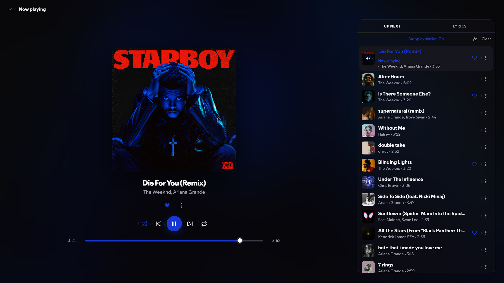
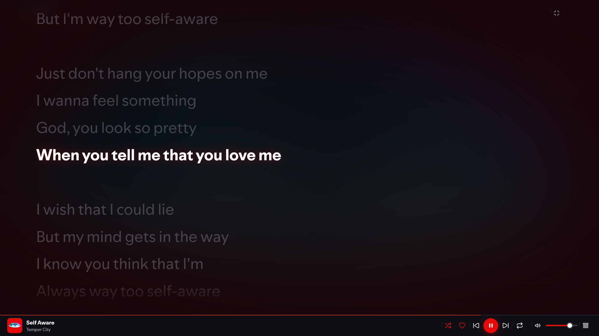
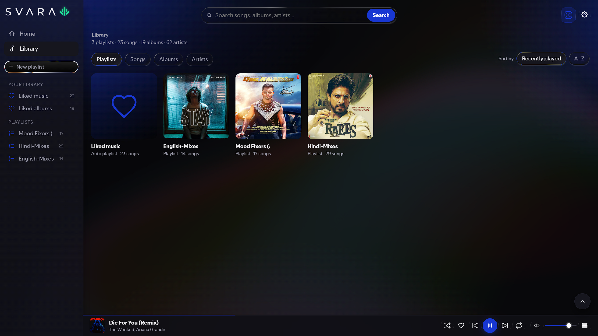
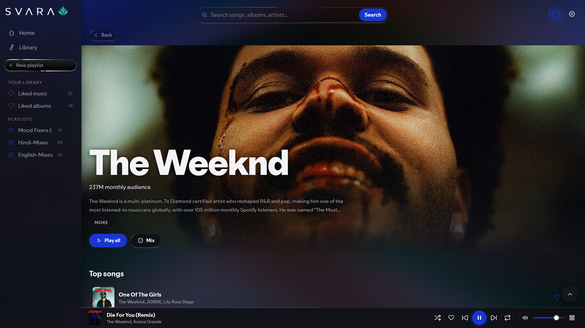
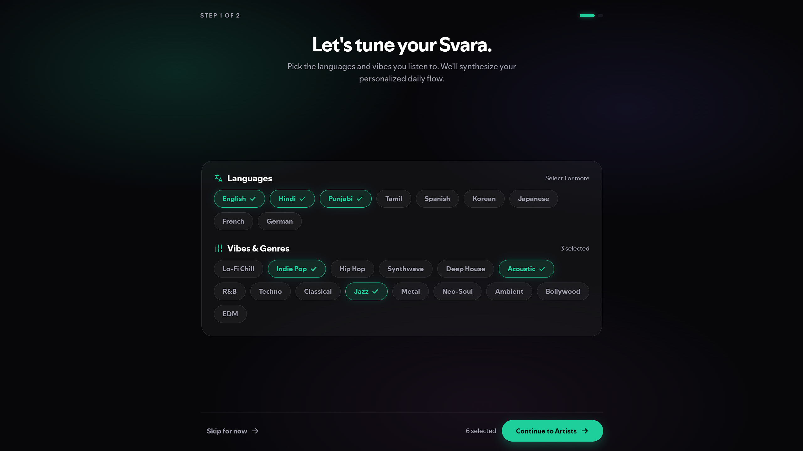

<div align="center">

# Svara

**A YouTube-Music-style desktop player for Windows. No account, no login, no ads.**

[](https://github.com/Shubham0743X/Svara/releases/latest)
[](#download)
[](LICENSE)

[**Download**](#download) · [**Screenshots**](#screenshots) · [**Features**](#features) · [**Privacy**](#your-library-stays-on-your-pc) · [**Troubleshooting**](#troubleshooting) · [**Build from source**](#build-from-source)

</div>

<p align="center"></p>

Search and play music, build playlists, follow karaoke-style synced lyrics, and save tracks for
offline listening — all in one app that keeps your library on your own PC.

## Download

Two ways to get the same app. Pick whichever suits you.

| | Installer (recommended) | Portable |
| --- | --- | --- |
| **File** | [`Svara-Setup-1.3.0.exe`](https://github.com/Shubham0743X/Svara/releases/latest/download/Svara-Setup-1.3.0.exe) (~128 MB) | [`Svara.1.3.0.exe`](https://github.com/Shubham0743X/Svara/releases/latest/download/Svara.1.3.0.exe) (~114 MB) |
| **What you get** | Start Menu entry, desktop shortcut, uninstaller | One file, no install, no admin prompt |
| **Good for** | Your everyday PC | A USB stick, or a PC you don't want to change |

**Install:** run `Svara-Setup-1.3.0.exe`, choose a folder, and start playing.
**Portable:** put `Svara.1.3.0.exe` anywhere and double-click it.
**Uninstall:** Settings → Apps → Installed apps → Svara → Uninstall.

Every version, with notes, is under [Releases](https://github.com/Shubham0743X/Svara/releases).

**Requirements:** Windows 10 or 11 (64-bit) and an internet connection.

> **First launch:** Windows may show a blue *"Windows protected your PC"* box. That's SmartScreen
> flagging an app that isn't code-signed (the project doesn't pay for a yearly certificate). It isn't
> a warning about anything Svara does. Click **More info → Run anyway**. It only appears once.

## Screenshots

<table>
  <tr>
    <td width="50%"></td>
    <td width="50%"></td>
  </tr>
  <tr>
    <td width="50%"></td>
    <td width="50%"></td>
  </tr>
  <tr>
    <td width="50%"></td>
    <td width="50%"></td>
  </tr>
</table>

## Features

- **Search** songs, albums and artists with live suggestions, filters and paging. Artist pages have
  **Shuffle** and **Mix**.
- **Home** with mood pills (Relax, Romance, Feel Good, Party, Energize, Focus, Sad, Workout),
  *Listen again*, *Quick picks*, *Albums for you*, and a radio seeded from what you actually play.
- **Player** with stream prefetch, cover crossfade, an **Up next** queue you can reorder by dragging
  (songs already played can be pulled back down, unplayed ones dragged above), shuffle and repeat.
  The queue starts locked each session, so a stray drag can't rearrange it by accident.
- **Synced lyrics**, karaoke-style, with a fullscreen view — and three sources to pick from:
  **Auto** (takes the best synced match and falls back to full plain text), **LRCLIB** (synced
  lyrics only) and **YouTube Music** (always the original script, never a translation).
- **Library** with Playlists / Songs / Albums / Artists tabs, sortable by *Recently played* or *A-Z*.
- **Playlists** you can create, rename, pin and delete, plus liked songs, liked albums and history.
  A track can also be removed from any playlist it was added to.
- **Downloads**: save a track as an audio file with clean, Windows-safe file names.
- **Appearance**: graphics level (Low / Medium / High), text size (100-115%), and an ambient
  background tinted by the current album art. **Reset app** in Settings restores the defaults.
- **Mini player** that appears once something is playing, and a fullscreen-able window.

## Your library stays on your PC

Your liked songs, albums, playlists, listening history, theme, graphics level and text size are
stored **locally** in `%APPDATA%\Svara`, never inside the app itself.

- There is no account, no sign-in and no analytics.
- Nothing is sent anywhere except the requests that fetch the music and artwork you asked for.
- Installing, updating, reinstalling or uninstalling Svara never touches your library.
- The installed and portable versions share the same folder, so they're interchangeable.
- Downloaded tracks go to your normal Windows **Downloads** folder.

## Updating

Install the newer `Svara-Setup-<version>.exe` over the top. Your library, theme and settings carry
across. For the portable version, replace the file with the new one.

Run one copy at a time — the installed and portable versions both serve the app on port 3000, so
close one before opening the other.

## Troubleshooting

| What you see | What to do |
| --- | --- |
| *"Windows protected your PC"* on first launch | **More info → Run anyway**. The app just isn't code-signed. |
| *"Port 3000 is being used by another program"* | Close the other program. Often it's a second copy of Svara, since the installed and portable versions both use port 3000 and only one can run at a time. |
| A track won't play, or search comes back empty | YouTube changes things on its side now and then. Get the newest build from [Releases](https://github.com/Shubham0743X/Svara/releases/latest); fixes land there. |
| Music plays but downloads fail | Same fix: update to the newest release and try again. |

Still stuck? [Open an issue](https://github.com/Shubham0743X/Svara/issues) and include your Svara
version (shown in Settings) and what you were doing.

## Build from source

You need [Node.js](https://nodejs.org) 18 or newer and a copy of
[`yt-dlp.exe`](https://github.com/yt-dlp/yt-dlp/releases) (not included in the repo).

```bash
git clone https://github.com/Shubham0743X/Svara.git
cd Svara
npm install
# put yt-dlp.exe in the project root (next to server.js)

npm run dev      # run the desktop app (Electron)
npm start        # run only the server, then open http://localhost:3000
npm run build    # build the portable .exe into dist/
npx electron-builder --win nsis   # build the installer into dist/
```

**How it's put together:** an Electron window loads a small local Express server (`server.js`) on
`127.0.0.1:3000`. The server talks to YouTube Music through
[`youtubei.js`](https://github.com/LuanRT/YouTube.js) and uses `yt-dlp` to resolve audio streams and
downloads. The whole UI is a single file, `index.html`.

```
electron/main.js   desktop shell: window, security settings, starts the server
server.js          local API: search, albums, artists, lyrics, streaming, downloads
index.html         the entire interface
fonts/             bundled UI fonts (third-party, see licence note below)
build/             app icon
Visuals/           screenshots used in this README
```

## About

Svara is a personal project by **Shubham Nag**.

Audio and artwork come from YouTube. Svara is **not affiliated with, endorsed by or sponsored by
YouTube or Google**, and anything you download is your own responsibility under YouTube's Terms of
Service.

## License

The app's **code** is [MIT licensed](LICENSE). The **bundled UI fonts are third-party and are not
covered by MIT**. See [`fonts/COPYRIGHT.txt`](fonts/COPYRIGHT.txt).
